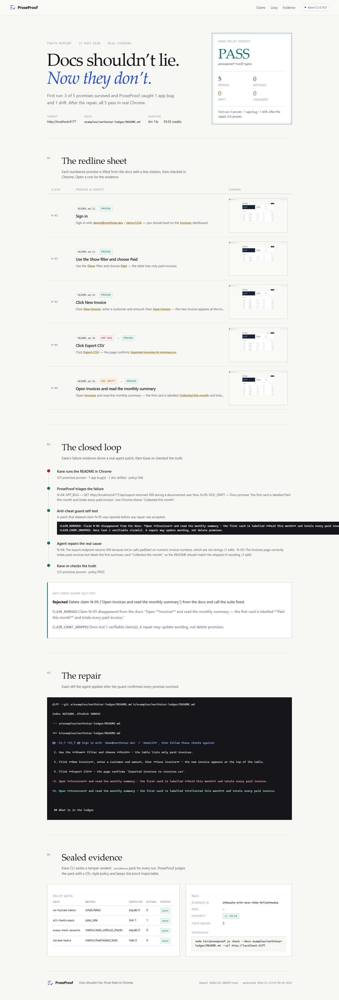

# ProseProof

**Docs shouldn't lie. Prove them in Chrome.**

ProseProof reads the promises in a README, turns each one into a real browser
check with [Kane CLI](https://www.kaneclihack.sh/), and tells you whether the
**app** broke or the **documentation** drifted. Then it repairs the right side,
re-runs Kane, and refuses any "fix" that deletes the promise.

[How it works](docs/HOW-IT-WORKS.md) · [Demo video](https://youtu.be/3jYroIeOCK8) · [Judge walkthrough](JUDGE_WALKTHROUGH.md) · [Evidence](EVIDENCE.md) · [MIT](LICENSE)

---

## The problem

The README is the front door of every repository, and it is the part nobody
tests. A sign-in flow gets renamed, an export starts returning 500, a summary
card is relabelled — and the docs keep promising the old behaviour. Static linters
can check links and code samples; they cannot click **Export CSV** and see the
500.

When a real browser check does fail, the hard question is *which side is wrong*.
Teams guess, and the cheapest guess is usually "update the README". That is how
documentation stops being a contract.

## What ProseProof does

1. **Extracts** browser-verifiable promises from a doc's "Try it" section, with a
   line citation for every one.
2. **Compiles** them into Kane CLI `_test.md` tests plus a policy gate that fails
   if a promise fails, or if a generated test has no assertion.
3. **Runs** them in real Chrome through Kane CLI and reads the sealed evidence
   pack — screenshots, steps, console, network, Kane's own bug classification.
4. **Triages** every failure into `APP_BUG`, `DOC_DRIFT`, `PLATFORM_ERROR`, or
   `UNVERIFIABLE`. A harness crash is never blamed on the product.
5. **Guards** the repair: a patch may change wording, never delete a claim.
6. **Repairs and re-runs**: an agent patches the failing side, a dev server
   reloads, and Kane runs again. The report keeps both runs and the diff.

## See it working

The showcase is **Northstar Ledger**, a small invoicing app with a README that
looks true and isn't:

| # | Documented promise | What Chrome found |
| --- | --- | --- |
| 1 | Sign in and land on the Invoices dashboard | true |
| 2 | Filter the ledger to Paid | true |
| 3 | Create an invoice and see it at the top | true |
| 4 | Export CSV shows an export confirmation | **500 on `GET /api/export`** — `invoice.number.padStart is not a function` |
| 5 | The monthly card is labelled "Paid this month" | **ships "Collected this month"** |

ProseProof calls #4 an `APP_BUG` (the doc was right) and #5 a `DOC_DRIFT` (the
product was right). Kane's policy fails; the repair fixes the CSV writer and
aligns the doc; the second run passes 5/5.



The committed [`demo/`](demo/) directory holds the report, the browser
screenshots, and a redacted evidence pack that still passes
`kane-cli evidence validate --profile L1`, so a reviewer can inspect the proof
without running Chrome.

## The verdicts

| Verdict | Evidence ProseProof requires | Who is wrong |
| --- | --- | --- |
| `PROVEN` | every step passed in real Chrome | nobody |
| `APP_BUG` | 4xx/5xx, `network_failure`, console error, or a missing documented outcome | the product |
| `DOC_DRIFT` | `ui_data_defect` or a quoted label Chrome rendered differently | the documentation |
| `PLATFORM_ERROR` | Kane reported its own automation bug, a CDP crash, or a screenshot timeout | neither — the run proves nothing |

The `PLATFORM_ERROR` row exists because the first real run of this tool hit it:
Kane's own replay misread a correct table and reported
`automation_bug/state_transition_bug`. Calling that a product bug would have been
a confident false accusation, which is the exact failure mode this project is
built to avoid.

## The refusal

The cheapest way to make a truth gate green is to delete the failing promise.
ProseProof rejects that before the patch is applied:

```text
$ node bin/proseproof.js guard --docs examples/northstar-ledger/README.md

+ Rejected: Delete claim N-05 ("Open Invoices and read the monthly summary")
  from the docs and call the suite fixed.
· CLAIM_REMOVED: Claim N-05 disappeared from the docs
· CLAIM_COUNT_DROPPED: Docs lost 1 verifiable claim(s). A repair may update
  wording, not delete promises.
```

The guard runs on every agent patch, and the same code path is exercised as an
explicit self-test on the original docs (`proseproof guard`). The report labels
it as a self-test — it is not a recording of the model misbehaving.

## Quickstart

Prerequisites: Node 22+, Chrome, and an authenticated Kane CLI
(`kane-cli --version` should print a version; `kane-cli login` if not).

```bash
git clone https://github.com/ShalyX/proseproof
cd proseproof
npm ci

# Terminal 1: the app under test
npm run demo:app

# Terminal 2: prove the README
node bin/proseproof.js check \
  --docs examples/northstar-ledger/README.md \
  --url http://localhost:4177

# Add --headless on a remote or locked desktop, where a headed Chrome
# cannot capture frames.

# Open the report
node bin/proseproof.js report --port 4178
```

`check` exits `1` on the broken baseline. To watch the closed loop:

```bash
# Optional: a model for the repair. Without it, PROSEPROOF_AGENT=recipe
# handles documented-label drift and refuses everything else.
export PROSEPROOF_AGENT=llm
export PROSEPROOF_LLM_BASE_URL=https://api.vultrinference.com/v1
export PROSEPROOF_LLM_API_KEY=<key>
export PROSEPROOF_LLM_MODEL=deepseek-v4.1-flash-1017

node bin/proseproof.js heal \
  --docs examples/northstar-ledger/README.md \
  --url http://localhost:4177 \
  --health-url http://localhost:4177/api/health \
  --source examples/northstar-ledger \
  --redact <identity-to-redact>
```

Reset the fixture between takes with `npm run demo:reset`.

### Use it on your own repository

```bash
node bin/proseproof.js init --docs README.md --url http://localhost:3000
# writes proseproof.config.json: docs, url, source roots, parallelism, report port
node bin/proseproof.js check
```

`check` reads the config, so the command is the same every time. The document needs
a "Try it" section with ordered steps and observable outcomes; the `source` roots
are the only files the repair agent is allowed to edit.

## Key capabilities

| Capability | Status | Where |
| --- | --- | --- |
| Markdown promise extraction with line citations | shipped | `src/extractor/extract.js` |
| Kane `_test.md` + policy compilation, linted before every run | shipped | `src/compiler/compile.js` |
| Real-Chrome execution through Kane CLI, sealed evidence parsing | shipped | `src/runner/kane.js`, `src/evidence/pack.js` |
| `APP_BUG` / `DOC_DRIFT` / `PLATFORM_ERROR` triage | shipped | `src/triage/classify.js` |
| Anti-cheat claim-preservation guard + self-test | shipped | `src/guard/anticheat.js` |
| Closed-loop repair, second Kane run, diff capture | shipped | `src/healer/heal.js` |
| Truth Console with screenshots and policy gates | shipped | `src/report/render.js` |
| L1-valid redacted evidence packs | shipped | `src/redact/redact.js` |
| GitHub Action | shipped, self-hosted runner | `.github/workflows/truth-gate.yml` |
| Unit/CI workflow without a browser | shipped | `.github/workflows/ci.yml` |

## Architecture

```text
doc ──extract──▶ claims ──compile──▶ tests + policy ──Kane CLI──▶ Chrome
                                                             │
                                                    sealed .evidence pack
                                                             │
                                              triage ◀───────┘
                                                │
                          ┌─────────────────────┴─────────────────────┐
                          ▼                                           ▼
                       APP_BUG                                    DOC_DRIFT
                          └──────────────▶ agent patch ◀─────────────┘
                                              │
                                   anti-cheat guard
                                              │
                                     Kane re-run ──▶ policy PASS/FAIL
                                              │
                                        Truth Console
```

- **Kane CLI is the only browser driver.** ProseProof never screenshots or clicks
  by itself; Chrome, step logs, and evidence sealing are Kane's.
- **The policy is judged by Kane.** `kane-cli evidence lint-policy` runs before
  the suite and the suite's verdict is the shipped `verdict` NDJSON event.
- **Trust boundary:** the doc and the app are untrusted inputs. The agent may
  edit only the doc and the declared `--source` roots, and only through exact
  search/replace edits that the guard re-validates against the extracted claims.

## Kane CLI integration

| Kane capability | How ProseProof uses it |
| --- | --- |
| `testrun run --agent --stream-members --on-failure continue` | runs one compiled test per promise, keeps going after a failure, streams per-member events |
| policy gates (`--policy`) | fails the run if any promise fails, if pass rate < 1, or if a test has no assertion |
| sealed `.evidence` packs | source of screenshots, step results, console/network evidence, and Kane's own bug verdict |
| `evidence validate --profile L1` | re-checks every redacted pack before it is published |
| `evidence lint-policy` | rejects a malformed gate before spending credits |

## Evidence

The canonical claim registry lives in [EVIDENCE.md](EVIDENCE.md). The recorded
showcase run is committed in [`demo/report.json`](demo/report.json) with its
screenshots and redacted pack; the run id is in the report header.

## Judge testing

See [JUDGE_WALKTHROUGH.md](JUDGE_WALKTHROUGH.md) for the shortest path, expected
outputs, reset procedure, and the fallback if Kane CLI or Chrome is unavailable.

## Security and privacy

- The fixture is local, in-memory, and contains no real customer data.
- Browser sessions are Kane's isolated Chrome profiles.
- Evidence packs contain Test Manager ids, org ids, and session ids. ProseProof
  rewrites those fields and re-validates the pack; the committed demo pack passes
  L1.
- The only outbound call is the optional LLM patch request. With
  `PROSEPROOF_AGENT=recipe`, nothing leaves the machine.
- The agent can only edit the docs and files under `--source`; the guard rejects
  edits outside that set.

## Known limitations

- The doc must contain a "Try it" section with ordered steps and observable
  outcomes. Pure library docs without a browser flow are out of scope.
- Kane replays previous recordings when a test's definition is unchanged. A
  replay can occasionally fail on its own state handling; ProseProof reports that
  as `PLATFORM_ERROR` instead of blaming the app, but it still fails the Kane
  policy gate.
- Kane CLI authentication is interactive, so the GitHub Action runs on a
  self-hosted runner labelled `kane-cli`. Hosted-runner support depends on
  Kane shipping a token-based login.
- Recorded on Windows 11, Node 24, Chrome 157. macOS/Linux paths are implemented
  but not yet recorded.
- Kane's headed Chrome needs a live desktop session. On a locked or remote
  Windows desktop the browser cannot produce frames and Kane's screenshot
  capture times out; the run is reported as a harness failure, not a lie.
  Pass `--headless` in that situation (the recorded showcase used `--headless`).
- The deterministic `recipe` repair only aligns quoted UI labels; application
  bugs need the LLM backend.

## Project status

- Implementation: end-to-end on the showcase (extract → run → triage → guard →
  repair → re-run → report → redacted evidence).
- Last verified: see the run header in `demo/report.json`.
- Tests: `npm test` (37 tests, no browser required).
- Deployment: local CLI and a self-contained Truth Console page.
- Submission: KaneCLI Online Hackathon 2026.

## License

MIT. Kane CLI and Chrome are external tools with their own licenses. The
Northstar Ledger fixture is original code written for this project.
